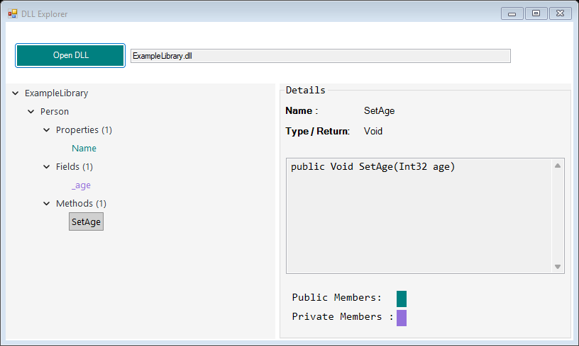

# DLL Explorer

DLL Explorer is a small Windows Forms application for exploring .NET DLL files.
It uses C# Reflection to show the types and members defined in an assembly.

This is a learning project focused on Reflection and building a simple desktop interface.

## Screenshot



The screenshot uses a small sample .NET library.

## Features

- Open a .NET DLL and display its file path.
- Browse types in a tree view.
- View properties, fields, and methods grouped by category.
- Select an item to see its name, type, and a simple signature.
- View a type's full name, namespace, and base type.
- Show a message when a file cannot be loaded or no types can be read.

Member names use these colors:

| Color | Access |
| --- | --- |
| Teal | Public |
| Purple | Private |
| Gray | Other access levels |

A property is shown as public when at least one of its accessors is public.

## How to use

1. Start the application.
2. Click **Open DLL** and select a .NET `.dll` file.
3. Expand a type, then open its **Properties**, **Fields**, or **Methods** group.
4. Select an item to view its details on the right.

## Requirements

- Windows.
- .NET Framework 4.7.2 or a compatible later version.

## Download a portable release

The portable Windows version is available in [release v1.0.0](https://github.com/amir-darwish/DLL_Explorer_REFLECTIONS/releases/tag/v1.0.0).

1. [Download the portable ZIP](https://github.com/amir-darwish/DLL_Explorer_REFLECTIONS/releases/download/v1.0.0/DLL-Explorer-v1.0.0-Portable.zip.zip).
2. Extract all files into a folder.
3. Run `DLL_Explorer.exe`.

No application installer or Visual Studio is needed. The required .NET Framework must be installed.

You can also find the portable ZIP under **Assets** on the [Releases page](https://github.com/amir-darwish/DLL_Explorer_REFLECTIONS/releases).
The automatically generated **Source code** archives contain the source files, not the ready-to-run application.

## Build from source

1. Open [DLL_Explorer.csproj](DLL_Explorer/DLL_Explorer.csproj) in Visual Studio with Windows Forms support and the .NET Framework 4.7.2 targeting pack installed.
2. Choose **Release** and build the project.
3. Find the application in `DLL_Explorer/bin/Release/`.

## Create a portable ZIP

After building, copy these files into a folder:

```text
DLL_Explorer/
    DLL_Explorer.exe
    DLL_Explorer.exe.config
    LICENSE
```

Include the `LICENSE` file from the repository root. You can zip this folder and attach it to a GitHub Release.

## Limitations

- The application reads .NET assemblies. Native C/C++ DLLs are not supported.
- It displays metadata, not the original source code or method bodies.
- Only members declared in each type are listed. Inherited members are not included.
- Signatures are simplified and do not show every C# modifier accurately.
- Missing dependencies or incompatible assemblies can prevent some types or members from being read.
- Some DLLs forward types to other assemblies and contain no types of their own. These may show only the assembly name and a message.

## Main files

- [Form1.cs](DLL_Explorer/Form1.cs): file selection, tree nodes, member colors, and displayed details.
- [Form1.Designer.cs](DLL_Explorer/Form1.Designer.cs): interface layout generated by the Visual Studio designer.
- [clsAssemblyReader.cs](DLL_Explorer/Services/clsAssemblyReader.cs): assembly loading and Reflection methods.

## License

This project is licensed under the [MIT License](LICENSE).
